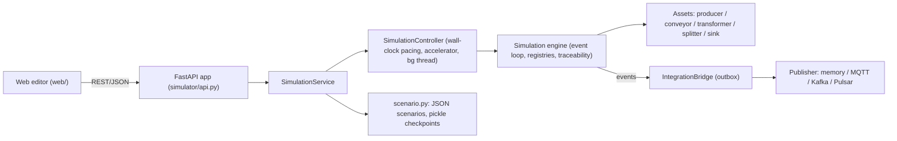

# Architecture and design decisions

| Module | Responsibility |
|---|---|
| `scheduler.py` | Deterministic priority queue. Lazy cancellation. Plain tuples, so it can be pickled |
| `engine.py` | `Simulation`: registries (types, recipes, orders, assets, products, cycles), event loop, product lifecycle, history, event log, config versioning, queries, DPP, invariants, metrics |
| `assets/*.py` | Behaviour of each asset kind. Each asset owns its buffers and its operational-history intervals |
| `curves.py` | Speed → time multiplier (piecewise linear) and speed → quality (logistic), with validation |
| `conditions.py` | Splitter routing rules (`eq ne lt le gt ge in not_in exists` on product fields and attributes) |
| `controller.py` | Real-time and accelerated pacing, pause/resume/step, background ticking |
| `integration.py` | Broker adapters, outbox bridge with retry, idempotent consumer |
| `scenario.py` | Scenario export/import (`format` validated), built-in scenarios, checkpoints |
| `api.py` | REST API, error mapping, static UI |

The engine knows nothing about the UI, HTTP or brokers. Everything outside it observes the engine
through listeners (`sim.listeners`, called with `(channel, payload)`) or queries.

## Clock

* **Event-driven.** Simulated time jumps from event to event. There is no fixed tick, so an idle line costs nothing.
* **Deterministic ordering.** Events at the same instant run in priority order: cycle completion,
  then conveyor arrival, then producer tick, then *wake*. Ties break on insertion sequence. Products,
  defects and ids come from a seeded RNG, so the same seed and scenario give an identical run.
* **Wake coalescing.** Whenever something might unblock an asset (an item leaves a buffer, a
  downstream slot frees up, a config change, a restart), the engine schedules at most one pending `wake`
  per asset at the current instant. Assets never call each other recursively. This *reentrancy rule*
  removes ordering bugs from push/pull chains. A guard aborts if a single instant processes an absurd
  number of events (an event storm).
* **Accelerator.** `sim_time = anchor_sim + (wall − anchor_wall) × acceleration`. Every acceleration
  change, pause or resume re-anchors at the current simulated time. That means:
  * changing the speed never resets the clock or replays events;
  * the duration of an operation already scheduled is unaffected, because durations are fixed in sim time when scheduled.

  The allowed range is (0, 10 000]. Every 20 ms the background thread processes all events up to the
  target time. If the host can't keep up, ticks take longer. Simulated causality is preserved, but the
  run falls behind wall time while still following the anchored target.
* **Step** advances N simulated seconds while paused (for tests and debugging).

## Material flow

* **Producer**: emits `batch_quantity` products every `interval` (unit: s/min/h) after `start_delay_s`.
  Each batch is a *production cycle* with its own lot number and order id, and an optional
  `defect_probability`. If the output is blocked, the batch is queued. Once pending products reach
  `max_pending_batches × batch_quantity`, further batches are skipped and recorded.
* **Conveyor**: FIFO. It holds `floor(length_m × capacity_per_m)` items and the transit time is
  `length_m / speed_m_s`. An item that reaches the end while the downstream input is full stays on the belt,
  and the conveyor is *blocked* (back-pressure). Positions shown in the UI are interpolated from entry time.
* **Transformer**: runs a recipe with 1–5 inputs and 1–3 outputs (products or by-products) on fixed ports. Only the ports used by the
  current recipe are exposed (`in0..`, `out0..`, labelled with quantity and product type).
  It starts a cycle when every input buffer has the required quantities and all output buffers have room.
  * Processing time is `recipe.processing_time_s × speed_multiplier(speed_pct)`.
  * Quality is `quality(speed_pct)`, and the defect probability is `1 − quality`.
    The default curve is 1.0 at 1 % speed, 0.999 at 50 % and 0.99 at 100 %
    (0.1 % defects at half speed, 1 % at full speed). Each transformer can override it with `quality_model`.
  * `defect_policy` is either `any_defective_input` (default: defects cascade, so outputs are defective if any
    consumed input was defective, otherwise drawn from machine quality) or `independent` (each output is drawn from
    machine quality only, ignoring input defects). Output history records `defect_cause`
    (`defective_input` / `machine_quality`).
  * At cycle start, the inputs become *reserved*. At completion they become *consumed*, and outputs are
    created with the inputs as parents.
* **Splitter**: has a percentage mode (deterministic; each product goes to the branch furthest below
  its target share, so deviation stays under one product) or a conditional mode (ordered rules, then a
  fallback branch). It has a small buffer.
* **Sink**: has a single input port (`in0`). It accepts some or all product types, up to an optional capacity. Products that meet the
  completion criteria become *completed*; the others become *stored*. It keeps statistics by type, lot,
  order, origin cycle and defectiveness.

### Product lifecycle

`in_transit` (conveyor) → `queued` (buffer) → `reserved` (cycle inputs) → `consumed`, or
`queued` → `completed`/`stored` (sink). Terminal products are never deleted. `check_invariants()` verifies:

* each active product is held by exactly one asset, at the matching location and status;
* reserved products belong to an active cycle;
* `created == active + consumed + completed + stored` (conservation).

## Traceability and Digital Product Passport

* A product has:
  * an immutable identity: id, label, type, lot, production timestamp, origin cycle, orders;
  * parents and children;
  * attributes;
  * an append-only **history** of activities.

  Each history activity records the case (order), asset, activity type, start and end, and attributes.
  The attributes include the config version and parameters in force.
* `GET /api/products/{id}` returns the DPP: identity, current state, provenance (parents, all
  ancestors, children, orders including upstream orders, operations) and a lineage tree.
  `GET /api/products/{id}/history` adds the ancestors' histories, which are marked `inherited`. Inheritance
  is resolved at query time instead of being copied into each product, so memory grows linearly.
* **Production cycles** snapshot the full asset configuration when they start (`config_snapshot`,
  `config_version`). Asset configs are replaced on update and never mutated in place, so the snapshot can
  share the dict safely.

## Runtime configuration changes

* `PATCH /api/assets/{id}/config` validates the merged config, then bumps `config_version`. It records a
  `ConfigChange` (`changes: {key: {old, new}}`) and emits `configuration_changed`.
* Effect policy, reported in `effective`:
  * transformer speed and recipe changes apply from the **next cycle**; the active cycle keeps its snapshot;
  * conveyor speed and length apply to items admitted from now on; items in transit keep their arrival time;
  * producer interval and batch changes apply from the next generated batch;
  * splitter and sink rules apply from the next product they handle.
* Stopping a conveyor freezes items in place, and restarting it re-applies their remaining travel time.
* Incompatible changes are rejected with 409 and leave the config untouched. Examples: a recipe without
  slots for the connected ports, or a recipe whose input types don't match the products already buffered.
  Invalid values are rejected with 422.
* Operational history gets a new interval whenever the state **or** the working conditions change.
  Re-labelling the same state at the same instant amends the open interval instead of adding a
  zero-length one.
* Commands: `stop`, `fault` (cancels the active cycle and restores its inputs to the buffer as `queued`),
  `start`/`restart`/`clear_fault`.

## Integration (brokers)

* The `IntegrationBridge` listens to engine events and appends JSON envelopes to an **outbox**.
  `deliver_pending()` publishes them in order and stops at the first failure, so ordering is preserved.
  It retries the same `event_id` with back-off and drops a message after `max_attempts`, counting the drop.
  Publishing never blocks or breaks the simulation.
* Delivery is at-least-once. `IdempotentConsumer` shows the receiver side: deduplicate by `event_id`.
* Metrics are published at most once per wall-second.

## Persistence

* **Scenario JSON** (`format: industrial-sim-scenario/v1`): catalog, assets, configs, positions and
  connections. It holds no runtime state. On import, everything is validated before replacing the
  current network.
* **Checkpoints** pickle the whole `Simulation` (scheduler, products, history, RNG state), so a run
  continues exactly where it stopped. Names must match `^[A-Za-z0-9_-]{1,64}$`.

## Performance

About 30–40k events/s on a single thread. 50 parallel lines run at about 289× real time, and memory is
about 7 KB per product including full history. See the README for the benchmark table. Options:
`Simulation(event_log_limit=N)` bounds the in-memory event log. The benchmark's `--no-trace` flag skips
`tracemalloc`, which gives faster runs but no memory figure.

## Known limitations

* No minimum spacing between items on a conveyor: capacity is enforced as a count, and items are not
  modelled physically.
* Pickle checkpoints must only be restored from **trusted** sources.
* There is no administrative correction or redaction of product history; it is strictly append-only.
* Product records, history and cycles stay in memory for the whole run. The event log is unbounded
  unless `event_log_limit` is set. Long, large runs need an external store (out of scope for the MVP).
* A sink that has received products can only be deleted after a reset, so traceability stays intact.
* After a cycle is cancelled, the restored inputs can temporarily push an input buffer above its
  nominal capacity. No new inputs are accepted until it drains.
* The MQTT, Kafka and Pulsar adapters are implemented but were not tested against real brokers in this
  environment. The in-memory adapter is fully tested.
* The UI polls instead of using websockets: state every 100 ms, events every 500 ms.
* Single process and a single simulation per server instance.
