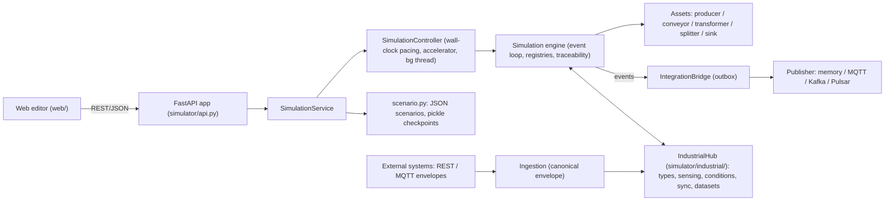

# Architecture and design decisions



| Module | Responsibility |
|---|---|
| `scheduler.py` | Deterministic priority queue. Lazy cancellation. Plain tuples, so it can be pickled |
| `engine.py` | `Simulation`: registries (types, recipes, orders, assets, products, cycles), event loop, product lifecycle, history, event log, config versioning, queries, DPP, invariants, metrics |
| `assets/*.py` | Behaviour of each asset kind. Each asset owns its buffers and its operational-history intervals |
| `curves.py` | Speed → time multiplier (piecewise linear) and speed → quality (logistic), with validation |
| `conditions.py` | Splitter routing rules (`eq ne lt le gt ge in not_in exists` on product fields and attributes) |
| `controller.py` | Real-time and accelerated pacing, pause/resume/step, background ticking |
| `integration.py` | Broker adapters, outbox bridge with retry, idempotent consumer |
| `scenario.py` | Scenario export/import (`format` validated), built-in scenarios, checkpoints |
| `api.py` | REST API, error mapping, static UI |
| `industrial/hub.py` | `IndustrialHub` (`sim.industrial`): asset-type registry, instance bindings, sensor sampling, composites, working conditions, behaviors, sync configuration, attribute resolution |
| `industrial/asset_types.py` | Versioned `AssetType` templates and per-instance `AssetBinding` (template snapshot, overrides, local items) |
| `industrial/definitions.py` | Validation and normalisation of profile sections, product attribute definitions and attribute mappings |
| `industrial/expressions.py` | Safe expression language (AST whitelist, no `eval`), compiled to pickle-safe trees |
| `industrial/measurements.py` | `Observation`, bounded measurement store, latest values and per-cycle aggregates |
| `industrial/ingestion.py` | Canonical external envelope, validation, deduplication, late/out-of-order handling, reconciliation |
| `industrial/mqtt.py` | MQTT subscriber feeding the ingestion layer (injectable client factory) |
| `industrial/datasets.py` | Continuous collector, collection sessions, dataset materialisation and CSV/JSONL/ZIP exporters |
| `industrial/units.py` | Unit conversion table used for ingested measurements |
| `web/app.js` | Canvas editor (nodes, conveyors, collision-free labels), toolbar and scenario files, inspector section registry, tabs |
| `web/forms.js` | Declarative form builder (fields, row widgets, previews) and form dialogs |
| `web/industrial.js` | Industrial-profile inspector section, asset-type form and JSON editors, datasets and ingestion tabs |

The engine knows nothing about the UI, HTTP or brokers. Everything outside it observes the engine
through listeners (`sim.listeners`, called with `(channel, payload)`) or queries.

## Clock

* **Event-driven.** Simulated time jumps from event to event. There is no fixed tick, so an idle line costs nothing.
* **Deterministic ordering.** Events at the same instant run in priority order: cycle completion,
  then conveyor arrival, then producer tick, then *wake*. Ties break on insertion sequence. Products,
  defects and ids come from a seeded RNG, so the same seed and scenario give an identical run.
* **Wake coalescing.** Whenever something might unblock an asset (an item leaves a buffer, a
  downstream slot frees up, a config change, a restart), the engine schedules at most one pending `wake`
  per asset at the current instant. Assets never call each other recursively. This *reentrancy rule*
  removes ordering bugs from push/pull chains. A guard aborts if a single instant processes an absurd
  number of events (an event storm).
* **Accelerator.** `sim_time = anchor_sim + (wall − anchor_wall) × acceleration`. Every acceleration
  change, pause or resume re-anchors at the current simulated time. That means:
  * changing the speed never resets the clock or replays events;
  * the duration of an operation already scheduled is unaffected, because durations are fixed in sim time when scheduled.

  The allowed range is (0, 10 000]. Every 20 ms the background thread processes all events up to the
  target time. If the host can't keep up, ticks take longer. Simulated causality is preserved, but the
  run falls behind wall time while still following the anchored target.
* **Step** advances N simulated seconds while paused (for tests and debugging).

## Material flow

* **Producer**: emits `batch_quantity` products every `interval` (unit: s/min/h) after `start_delay_s`.
  Each batch is a *production cycle* with its own lot number and order id, and an optional
  `defect_probability`. If the output is blocked, the batch is queued. Once pending products reach
  `max_pending_batches × batch_quantity`, further batches are skipped and recorded.
* **Conveyor**: FIFO. It holds `floor(length_m × capacity_per_m)` items and the transit time is
  `length_m / speed_m_s`. An item that reaches the end while the downstream input is full stays on the belt,
  and the conveyor is *blocked* (back-pressure). Positions shown in the UI are interpolated from entry time.
* **Transformer**: runs a recipe with 1–5 inputs and 1–3 outputs (products or by-products) on fixed ports. Only the ports used by the
  current recipe are exposed (`in0..`, `out0..`, labelled with quantity and product type).
  It starts a cycle when every input buffer has the required quantities and all output buffers have room.
  * Processing time is `recipe.processing_time_s × speed_multiplier(speed_pct)`.
  * Quality is `quality(speed_pct)`, and the defect probability is `1 − quality`.
    The default curve is 1.0 at 1 % speed, 0.999 at 50 % and 0.99 at 100 %
    (0.1 % defects at half speed, 1 % at full speed). Each transformer can override it with `quality_model`.
  * `defect_policy` is either `any_defective_input` (default: defects cascade, so outputs are defective if any
    consumed input was defective, otherwise drawn from machine quality) or `independent` (each output is drawn from
    machine quality only, ignoring input defects). Output history records `defect_cause`
    (`defective_input` / `machine_quality`).
  * At cycle start, the inputs become *reserved*. At completion they become *consumed*, and outputs are
    created with the inputs as parents.
* **Splitter**: has a percentage mode (deterministic; each product goes to the branch furthest below
  its target share, so deviation stays under one product) or a conditional mode (ordered rules, then a
  fallback branch). It has a small buffer.
* **Sink**: has a single input port (`in0`). It accepts some or all product types, up to an optional capacity. Products that meet the
  completion criteria become *completed*; the others become *stored*. It keeps statistics by type, lot,
  order, origin cycle and defectiveness.

### Product lifecycle

`in_transit` (conveyor) → `queued` (buffer) → `reserved` (cycle inputs) → `consumed`, or
`queued` → `completed`/`stored` (sink). Terminal products are never deleted. `check_invariants()` verifies:

* each active product is held by exactly one asset, at the matching location and status;
* reserved products belong to an active cycle;
* `created == active + consumed + completed + stored` (conservation).

## Traceability and Digital Product Passport

* A product has:
  * an immutable identity: id, label, type, lot, production timestamp, origin cycle, orders;
  * parents and children;
  * attributes;
  * an append-only **history** of activities.

  Each history activity records the case (order), asset, activity type, start and end, and attributes.
  The attributes include the config version and parameters in force.
* `GET /api/products/{id}` returns the DPP: identity, current state, provenance (parents, all
  ancestors, children, orders including upstream orders, operations) and a lineage tree.
  `GET /api/products/{id}/history` adds the ancestors' histories, which are marked `inherited`. Inheritance
  is resolved at query time instead of being copied into each product, so memory grows linearly.
* **Production cycles** snapshot the full asset configuration when they start (`config_snapshot`,
  `config_version`). Asset configs are replaced on update and never mutated in place, so the snapshot can
  share the dict safely.

## Runtime configuration changes

* `PATCH /api/assets/{id}/config` validates the merged config, then bumps `config_version`. It records a
  `ConfigChange` (`changes: {key: {old, new}}`) and emits `configuration_changed`.
* Effect policy, reported in `effective`:
  * transformer speed and recipe changes apply from the **next cycle**; the active cycle keeps its snapshot;
  * conveyor speed and length apply to items admitted from now on; items in transit keep their arrival time;
  * producer interval and batch changes apply from the next generated batch;
  * splitter and sink rules apply from the next product they handle.
* Stopping a conveyor freezes items in place, and restarting it re-applies their remaining travel time.
* Incompatible changes are rejected with 409 and leave the config untouched. Examples: a recipe without
  slots for the connected ports, or a recipe whose input types don't match the products already buffered.
  Invalid values are rejected with 422.
* Operational history gets a new interval whenever the state **or** the working conditions change.
  Re-labelling the same state at the same instant amends the open interval instead of adding a
  zero-length one.
* Commands: `stop`, `fault` (cancels the active cycle and restores its inputs to the buffer as `queued`),
  `start`/`restart`/`clear_fault`.

## Integration (brokers)

* The `IntegrationBridge` listens to engine events and appends JSON envelopes to an **outbox**.
  `deliver_pending()` publishes them in order and stops at the first failure, so ordering is preserved.
  It retries the same `event_id` with back-off and drops a message after `max_attempts`, counting the drop.
  Publishing never blocks or breaks the simulation.
* Delivery is at-least-once. `IdempotentConsumer` shows the receiver side: deduplicate by `event_id`.
* Metrics are published at most once per wall-second.

## Persistence

* **Scenario JSON** (`format: industrial-sim-scenario/v1`): catalog, assets, configs, positions and
  connections, plus asset types, instance bindings, sync settings and dataset definitions. It holds no runtime state. On import, everything is validated before replacing the
  current network.
* **Scenario files** live in `scenarios/` (`SimulationService(scenario_dir, scenario_id)`). The service
  tracks the current file id (`None` after an import or before the first save). `POST /api/scenarios`
  writes a new file holding an empty plant; the product catalogue and asset types are copied unless
  `keep_catalog` / `keep_asset_types` are false. `PUT /api/scenarios/{id}` saves (409 unless
  `overwrite=true` or `id` is the current file), and `POST /api/scenarios/{id}/rename` renames the
  file and/or the display name. File ids are validated with the same pattern as checkpoint names.
  The scenario `description` is exported and loaded with the definition.
* **Checkpoints** pickle the whole `Simulation` (scheduler, products, history, RNG state), so a run
  continues exactly where it stopped. Names must match `^[A-Za-z0-9_-]{1,64}$`.

## Performance

About 30–40k events/s on a single thread. 50 parallel lines run at about 289× real time, and memory is
about 7 KB per product including full history. See the README for the benchmark table. Options:
`Simulation(event_log_limit=N)` bounds the in-memory event log. The benchmark's `--no-trace` flag skips
`tracemalloc`, which gives faster runs but no memory figure.

## Industrial extension

The industrial layer lives in `simulator/industrial/`. `IndustrialHub` is owned by the `Simulation`
(`sim.industrial`), so its state is pickled with checkpoints and reset with the simulation. Assets
without an industrial profile never reach this code, so their behaviour and determinism are unchanged.

### Asset types and instances

* An **asset type** bundles a kind, a default config and a *profile* with five sections: `parameters`,
  `sensors`, `composites`, `conditions` and `behaviors`. Every update bumps the type `version` and adds a
  changelog entry.
* Deploying a type onto an asset stores a **binding**: the template snapshot of that version, the
  instance `overrides` (config values, parameter values, partial patches of template items by id) and
  `local` items that exist only on that instance.
* Template changes never alter running instances. Bound instances become *outdated* and are synchronised
  explicitly, with a dry-run diff available, and their overrides are preserved. A deploy or sync that
  would produce an invalid profile is rolled back.
* Every asset class has a **default type** (`default-<kind>`, empty profile), created by
  `IndustrialHub.ensure_default_types()` when the service starts and whenever a scenario is installed.
  Assets and conveyors created through the API (or the editor palette) are bound to it automatically, so
  sensors or conditions added to the default type later reach every such instance via the usual explicit
  sync. Assets loaded from a scenario file keep the bindings stored in the file.

### Sensing, composites, conditions and behaviors

* **Expressions** (`sensor.temp`, `param.setpoint`, `composite.health`, `state.running`,
  `cycle.progress`, …) are parsed with `ast` and converted to whitelisted tuple trees. Size, node count
  and nesting depth are bounded. A missing variable raises `MissingValue`, and each caller applies its
  own missing-value policy.
* **Simulated sensors** sample on the scheduler event `ind:sample` every `sample_interval_s`. Models are
  `constant`, `expression`, `first_order` (lag towards a target expression) and `random_walk`. The raw
  value then passes through noise, gain, offset, resolution, range and an optional filter
  (`moving_average` or `ema`). All randomness comes from the seeded simulation RNG.
* Every value, whether simulated, ingested or computed, becomes an **observation**. It carries the asset,
  measurement, unit, sim time, source, quality, cycle and original timestamps. The measurement store keeps
  a bounded history, the latest *valid* value and incremental per-cycle aggregates
  (initial/final/avg/min/max/count). Composites are re-evaluated in dependency order whenever an input
  changes, and composite cycles are rejected.
* **Working conditions** have activation and deactivation expressions (hysteresis) plus
  `delay_on_s`/`delay_off_s`. Delayed transitions are scheduled as `ind:cond`, and re-evaluations
    triggered by new values are coalesced into one `ind:eval` event at the current instant.
  * Active conditions apply **effects** (`multiply`, `add`, `set`, `min`, `max`) to cycle features such as
    `processing_time_s`, `speed_pct`, `quality_score` or `defect_probability`.
  * Their **action** is one of `none`, `block` (no new cycles start), `stop` or `fault`.
  * Transitions are recorded in the operational history and emitted as events.
* **Behaviors** map parameters and measurements to an asset feature (e.g. `speed_pct = self * 1.1`
  `when composite.health > 0.98`), clamped to the feature bounds. Invalid inputs fall back to the
  nominal value. Features and parameters are snapshotted when a cycle starts, so a cycle in progress is
  never affected by later changes.

### Product attributes

* Product types declare typed attributes (type, unit, min/max, allowed values, required, default).
* Recipe outputs and producers fill them through **attribute mappings**. The sources are `constant`,
  `parameter`, `measurement` (a cycle aggregation), `feature`, `input` (an aggregation over consumed
  products), `expression`, `order`, `cycle` and `condition`. A mapping can carry `when`, `scale`,
  `offset` and an `on_missing` policy.
* Mappings are snapshotted at cycle start and resolved at completion. Every value records its provenance,
  which the DPP exposes.

### External synchronisation

* Each asset has a sync configuration:
  * `mode`: `simulation`, `external` or `hybrid`. In hybrid mode, each category (`production`,
    `measurements`, `configuration`, `state`) is chosen independently.
  * `external_id`.
  * `reconciliation`: `strict` or `lenient`.
  * `late_policy`: `store`, `apply` or `discard`.
  * `time_mode`: `arrival` or `source`.
  * `max_lateness_s` (default 30).
* REST and MQTT both convert their payloads to one **canonical envelope** (`schema_version` "1.0") and call
  `ingest()` while holding the controller lock. External events are therefore applied atomically
  between simulation events.
* A message is validated completely before any mutation, so a rejected message changes nothing.
  Duplicates are detected by `event_id`, using a bounded memory.
* Measurements are converted to the sensor's unit. Late and out-of-order values are stored with their
  quality, and the late policy decides whether they update the latest value.
* `cycle_completed` for a cycle that hasn't started yet is kept **pending** under lenient reconciliation
  and applied when the start arrives. Strict reconciliation rejects it.
* External production replaces simulated production for that asset. A sensor whose `source` is `auto`
  follows the asset's `measurements` category; `simulated` or `external` pins it either way.
* The MQTT broker connection is configured separately from the assets. If the broker can't be reached,
  the client retries in the background while the simulation keeps running.

### Datasets

* A continuous collector and up to 50 named **collection sessions** observe the simulation, covering
  simulated and ingested data alike.
  * Sessions have a lifecycle (`created`, `scheduled`, `running`, `paused`, `stopped`, `completed`) and
    start/end conditions (time, duration, cycle or product count).
  * Each session records the time segments it was running.
* There are four datasets, which join on `asset_id`, `cycle_id`, `product_id` and `production_order_ids`:
  `sensor`, `cycle`, `product` and `machine`.
  * Raw observations and machine records are captured live, with row caps.
  * Cycle and product rows are **materialised at export time** from the engine's authoritative records,
    so later product updates show up and retried events can't create duplicate rows.
* Exporters are registered in `EXPORTERS`: CSV is the reference format and JSONL is a second example.
  ZIP bundles add a manifest.
* Dataset definitions, along with asset types, bindings and sync settings, are part of the scenario JSON.
  Scenario C (`scenarios/scenario_c_industrial_furnaces.json`) is a complete example. Its two typed
  furnaces have a simulated and a hybrid instance, attribute mappings and a ready-to-start dataset
  session.

## Web editor

The UI is plain JavaScript without a build step (`forms.js`, then `app.js`, then `industrial.js`).
The asset inspector is a registry of **sections**, so new kinds of information can be added without
touching the existing code:

```js
registerInspectorSection({
  id: "my-section", order: 45,            // position among the other sections
  title: "My section", kinds: ["sink"],   // optional filter by asset kind
  collapsible: true, collapsed: false,    // open/closed state is remembered per section
  summary: (asset, shared) => "html",     // shown in the header, also when collapsed
  actions: (asset) => [{ label: "Edit…", run: (asset, shared) => openSomeDialog(asset) }],
  async mount(asset, body, shared, sec) { body.innerHTML = "…"; },          // first render
  async refresh(asset, body, shared, prev, sec) { /* update in place */ },  // live updates
});
```

* A selection change builds all sections off-screen, waits for every `mount`, and swaps them in
  once, so there is no partial or flickering render. A token discards results of outdated renders.
* While the simulation runs, the inspector calls each section's `refresh`, which updates only the
  values that changed (`setHtml` skips identical HTML). The DOM structure, scroll position, open
  `<details>`, focus and input being typed are kept. Statistics and the active-cycle card use
  fixed-layout tables and truncated ids, so changing values cannot widen the panel.
* Advanced configuration groups, attribute mappings, synchronisation settings and the per-device
  API reference are summarised on one line and edited or shown in modals (`openFormDialog`,
  `openJsonDialog`), which keeps the panel short.
* Canvas labels (port labels and conveyor names) are placed greedily: each label tries several
  positions along and beside its line and takes the first one that does not overlap a node or a label
  already placed.

## Known limitations

* No minimum spacing between items on a conveyor: capacity is enforced as a count, and items are not
  modelled physically.
* Pickle checkpoints must only be restored from **trusted** sources.
* There is no administrative correction or redaction of product history; it is strictly append-only.
* Product records, history and cycles stay in memory for the whole run. The event log is unbounded
  unless `event_log_limit` is set. Long, large runs need an external store (out of scope for the MVP).
* A sink that has received products can only be deleted after a reset, so traceability stays intact.
* After a cycle is cancelled, the restored inputs can temporarily push an input buffer above its
  nominal capacity. No new inputs are accepted until it drains.
* The MQTT, Kafka and Pulsar adapters are implemented but were not tested against real brokers in this
  environment. The in-memory adapter is fully tested.
* The UI polls instead of using websockets: state every 100 ms, events every 500 ms.
* Single process and a single simulation per server instance.
